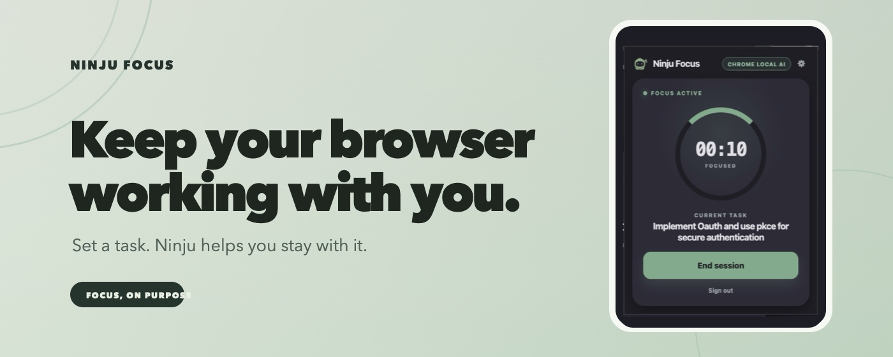
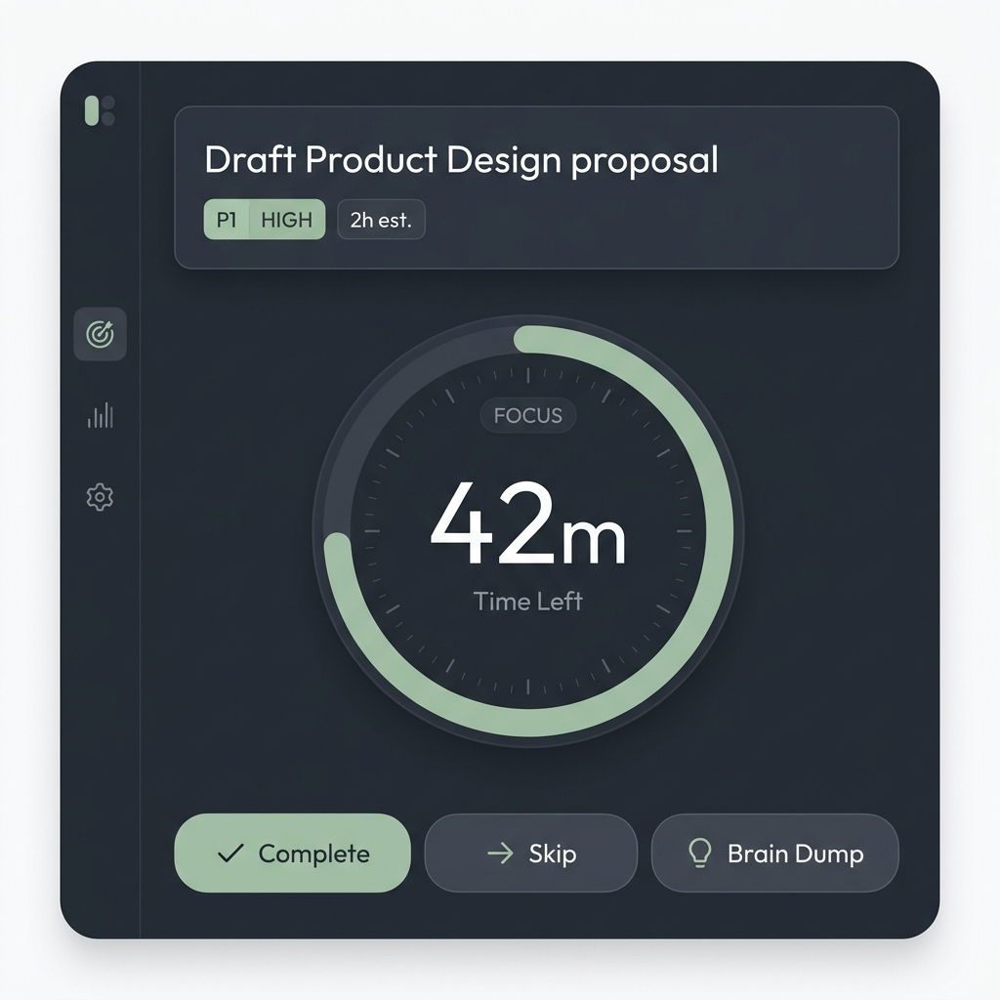
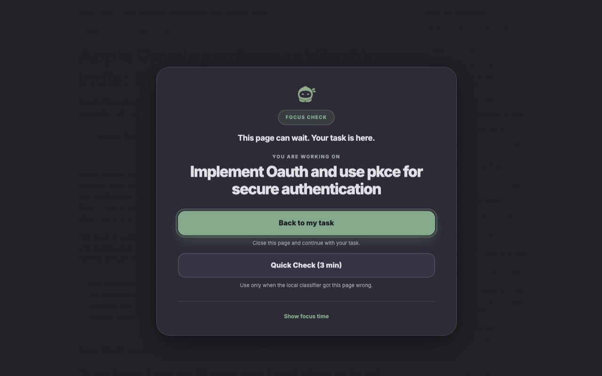
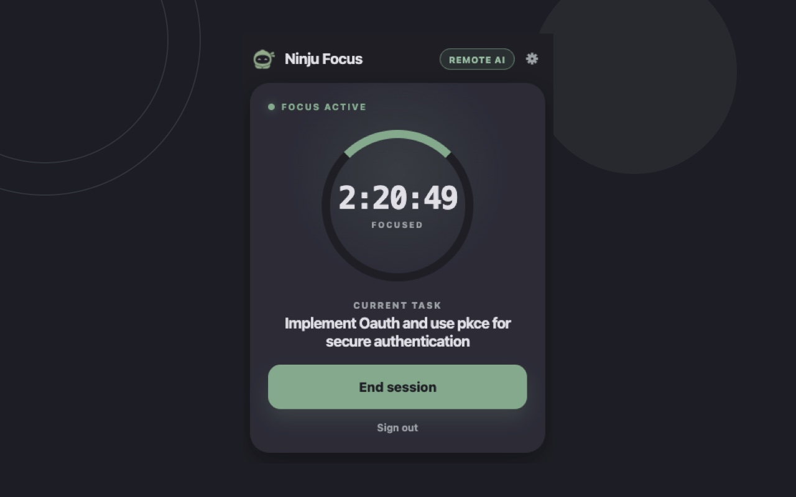
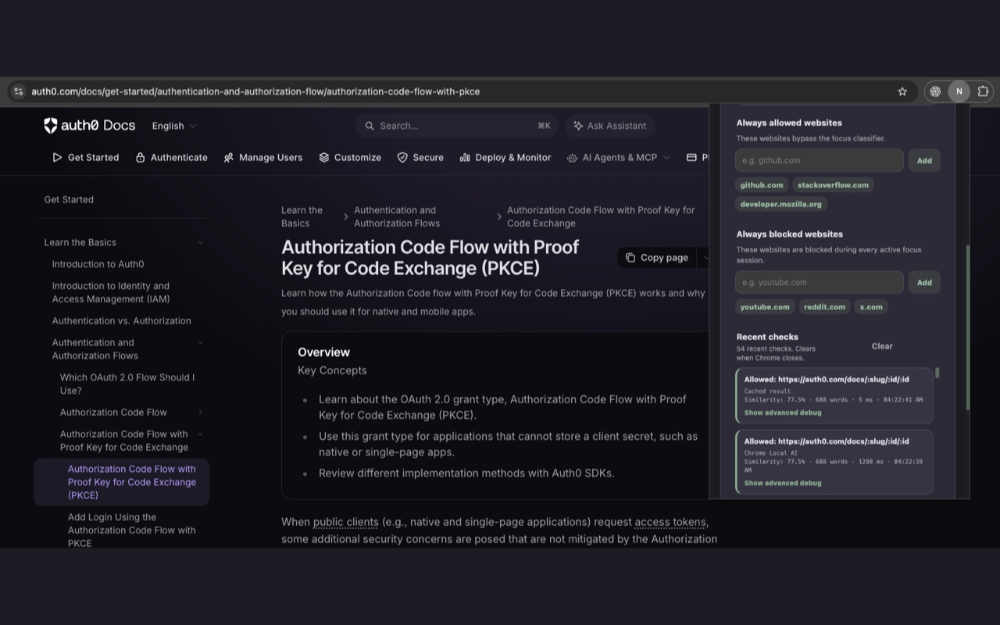

# Ninju — Stay on the Right Task

[](https://www.ninju.app)

### The calm focus cockpit & task-aware distraction blocker for AI-powered developers and ADHD minds.

[](https://www.ninju.app)
[-000000?style=for-the-badge&logo=apple&logoColor=white)](https://www.ninju.app/downloads)
[](https://chromewebstore.google.com/detail/ninju-focus-smart-distrac/likhkimckoknkgcniafjeejijkhmjmcn)
[](https://github.com/NinjuApp/ninju-releases/releases/latest)

[**The Problem**](#-the-problem) • [**The Power Duo**](#-desktop-app--chrome-extension-the-power-duo) • [**Visual Tour**](#-visual-tour) • [**Download & Install**](#-downloads--installation) • [**Why Ninju**](#-feature-comparison) • [**Privacy First**](#-privacy--architecture) • [**FAQ**](#-frequently-asked-questions)

---

## 💡 The Problem

### AI helps you code faster. Ninju keeps you on the right task.

With modern AI coding assistants, code generation and debugging have become virtually instantaneous. But for developers, engineers, and neurodivergent minds with ADHD, the bottleneck has shifted from syntax to **executive function**:

* **🌀 The Distraction Spiral**: You open a browser tab to look up an API documentation snippet, and 45 minutes later you are trapped in a YouTube rabbit hole, Reddit thread, or social media feed.
* **🔨 Blunt Site Blockers Break Developer Workflows**: Traditional blockers use rigid domain blacklists. But developers *need* YouTube for tech conference talks and tutorials, Reddit for niche library workarounds, and GitHub for open-source issues. Blocking the entire internet is impossible; unblocking it destroys deep focus.
* **⏳ Time Blindness & Pomodoro Panic**: Aggressive countdown timers trigger anxiety, panic, or ADHD freeze states. When a timer ticks down, it creates false urgency instead of calm momentum.
* **🏔️ Oversized Tasks & Cognitive Overload**: Vague issues like *"Refactor payment module"* cause paralysis and procrastination. Meanwhile, intrusive side-thoughts pull you away from your active thread.

**[Ninju](https://www.ninju.app)** is built as an external cognitive cockpit. It couples a **native macOS menu bar app** with the **Ninju Focus Chrome extension** to anchor your intent and eliminate distractions without policing your day.

---

## ⚡ Desktop App + Chrome Extension: The Power Duo

Ninju is not another task manager—it is your **execution layer**. Planning stays in Jira or Linear; execution becomes calm and protected.

| 🖥️ The Anchor: macOS Cockpit | 🧩 The Shield: Ninju Focus for Chrome |
| :---: | :---: |
| [](https://www.ninju.app/downloads) | [](https://www.ninju.app/ninju-focus-extension) |
| **Keeps active intention front and center:**<br/>• **One Task at a Time**: Syncs directly with Jira Cloud or local tasks.<br/>• **Calm Count-Up Timer**: Tangible elapsed time without countdown panic.<br/>• **Thought Parking Lot**: Park fleeting distractions in seconds.<br/>• **AI Task Breakdown**: Splits oversized tickets into 5–6 atomic steps.<br/>• **Daily Standup Summary**: Generates natural-language standup updates. | **Evaluates browsing against your active task:**<br/>• **Task-Aware Blocking**: Relevant docs & issue trackers stay open.<br/>• **Dynamic Relevance**: YouTube is blocked during bugfixes, allowed during research.<br/>• **Gentle Detour Pause**: Serene pause screen guides you back to focus.<br/>• **On-Device AI**: Powered by local Apple models & WebAssembly redaction.<br/>• **Zero Surveillance**: No keystrokes, no screen captures, no history selling. |

### How They Work Together in Real Life

```
[ Active Jira / Linear Task ]
            │
            ▼
┌────────────────────────────────────────────────────────────────────────┐
│                      NINJU DESKTOP COCKPIT                             │
│   Task: "Ship OAuth callback error states" (DEV-231)                   │
│   Timer: 24:18 elapsed  •  Estimate: 30 min                            │
└───────────────────────────────────┬────────────────────────────────────┘
                                    │ Broadcasts Active Context
                                    ▼
┌────────────────────────────────────────────────────────────────────────┐
│                   NINJU FOCUS CHROME EXTENSION                         │
│                                                                        │
│   Browsing developer.chrome.com  ──► [ALLOWED] Relevant docs           │
│   Browsing atlassian.com         ──► [ALLOWED] Ticket & OAuth spec     │
│   Browsing youtube.com/feed      ──► [PAUSED]  Gentle detour screen    │
│                                                                        │
│   * Switching to: "Research video demo recording tools"                │
│   Browsing youtube.com/watch?... ──► [ALLOWED] Relevant to new task!   │
└────────────────────────────────────────────────────────────────────────┘
```

> [!TIP]
> **Relevance changes with your task.** Traditional blockers use static domain lists that force you to toggle them on and off. Ninju knows what you are trying to accomplish and protects that specific intention.

---

## 📸 Visual Tour

### 1. Active Focus & Transparent Decision Engine

| ⚡ Active Focus Session | 🛡️ Custom Rules & Audit Logs |
| :---: | :---: |
|  |  |
| *Real-time task goal and quick controls directly in Chrome.* | *Full transparency into every allow/pause decision with manual overrides.* |

### 2. Core Cockpit Capabilities

<details open>
<summary><b>🎯 Single-Task Cockpit (No Backlog Overwhelm)</b></summary>

Planning belongs in Jira or Linear; execution needs quiet. Ninju pulls the next item from your sprint and isolates it into a clean, floating window or minimal macOS menu bar pill. You only see what needs your attention right now.
</details>

<details open>
<summary><b>⏱️ Anxiety-Free Time Visibility</b></summary>

Instead of a ticking red clock inducing adrenaline rushes, Ninju uses a gentle count-up timer. When elapsed time exceeds your estimate, Ninju doesn't sound an alarm—it provides a respectful check-in asking if you encountered a blocker or want to adjust your estimate.
</details>

<details open>
<summary><b>💡 "Park the Thought, Keep the Thread"</b></summary>

ADHD brains are idea machines. When an unrelated stroke of genius or random task hits during deep flow, tap a shortcut to open the **Thought Parking Lot**. Jot it down in 3 seconds, and Ninju safely preserves it in local SQLite so your working memory stays clear.
</details>

<details open>
<summary><b>🧠 AI Task Breakdown</b></summary>

Stuck staring at a massive ticket? Press **Break Down Task** and Ninju AI drafts 5–6 atomic, sequential micro-steps complete with estimated minutes. Review, edit, or customize them before committing—nothing is forced.
</details>

<details open>
<summary><b>📝 Automated Daily Standup Summary</b></summary>

At the end of your workday or the start of morning standup, Ninju summarizes your completed tasks, debugging notes, and focused sessions into a natural-language update. Review it and copy it to Slack or Jira in one click—Ninju never auto-broadcasts your work.
</details>

---

## 🚀 Downloads & Installation

Ninju for macOS is built natively with Rust and Tauri 2.0. Every binary is digitally signed and notarized by Apple.

### 1. macOS Desktop App

| Platform | Processor Architecture | Installer (.dmg) | Release Notes |
|:---|:---|:---:|:---:|
| **Apple Silicon** *(Recommended)* | Apple M1, M2, M3, M4 | [**Download DMG (Apple Silicon)**](https://github.com/NinjuApp/ninju-releases/releases/latest) | [View v0.6.0 Notes](https://github.com/NinjuApp/ninju-releases/releases/latest) |
| **Intel Mac** | Core i5, i7, i9 | [**Download DMG (Intel)**](https://github.com/NinjuApp/ninju-releases/releases/latest) | [View v0.6.0 Notes](https://github.com/NinjuApp/ninju-releases/releases/latest) |

*You can also visit the official **[Ninju Downloads Hub](https://www.ninju.app/downloads)** for web-based downloads and system requirements.*

#### Quick Install:
```bash
# 1. Download the .dmg from GitHub releases or ninju.app
# 2. Open the .dmg and drag Ninju into Applications:
cp -R "/Volumes/Ninju/Ninju.app" /Applications/

# 3. Launch Ninju via Spotlight:
open /Applications/Ninju.app
```

### 2. Chrome Extension

Install **Ninju Focus** directly from the Chrome Web Store:

[](https://chromewebstore.google.com/detail/ninju-focus-smart-distrac/likhkimckoknkgcniafjeejijkhmjmcn)

*Fully compatible with Google Chrome, Brave, Arc, Microsoft Edge, and all Chromium browsers.*

---

## 📊 Feature Comparison

| Feature | Standard Site Blockers | Basic Pomodoro Apps | Ninju Cockpit + Focus |
|:---|:---:|:---:|:---:|
| **Task-Contextual Filtering** | ❌ Static domain lists | ❌ None | ✅ **Dynamic AI evaluation based on active goal** |
| **Allows Technical Research** | ❌ Blocks needed video/forums | ❌ N/A | ✅ Keeps useful documentation and tutorials open |
| **Timer Feel** | ⚠️ Stressful countdowns | ⚠️ Alarm clock anxiety | ✅ **Calm, visible elapsed count-up** |
| **ADHD Executive Support** | ❌ None | ❌ None | ✅ AI task splitter & thought parking lot |
| **Project Tracker Sync** | ❌ None | ❌ None | ✅ **Direct Atlassian Jira Cloud & Linear sync** |
| **Daily Standup Generator** | ❌ None | ❌ None | ✅ One-click natural language daily summaries |
| **Data Privacy** | ⚠️ Often sells browsing data | ⚠️ Heavy cloud telemetry | ✅ **100% Local SQLite storage & on-device AI** |

---

## 🔒 Privacy & Architecture

We built Ninju on the fundamental rule that **software should empower people, not surveil them**:

* **🛡️ 100% Local Storage**: Your tasks, notes, sessions, and timer logs live exclusively in a local SQLite database on your Mac (`~/Library/Application Support/com.doctorxlabs.ninju/ninju.db`).
* **🚫 Zero Workplace Surveillance**: Ninju does not record your screen, does not log keystrokes, does not monitor IDE code, and does not report activity to employers.
* **🔒 Client-Side PII Scrubbing**: The Chrome extension strips query parameters and runs an in-browser WebAssembly redaction engine to strip sensitive patterns (emails, tokens, keys) before any content is evaluated.
* **⚡ On-Device Intelligence**: Integrates with Apple Foundation models over a local macOS native messaging helper, allowing offline and private classification.

Read our complete [Ninju Desktop Privacy Policy](https://www.ninju.app/privacy) and [Browser Extension Privacy Policy](https://www.ninju.app/privacy/browser-extension).

---

## ❓ Frequently Asked Questions

<details>
<summary><b>Does Ninju replace Jira or Linear?</b></summary>
<p>No. Jira and Linear are where teams collaborate and plan sprints. Ninju is the personal execution layer you use to actually get through the work without distraction. It imports tickets directly so you don't have to keep heavy project management tabs open.</p>
</details>

<details>
<summary><b>How does the Chrome extension decide what to block?</b></summary>
<p>Ninju Focus evaluates the high-level intent of your active task against the page metadata (title, headings, and redacted content). If you are building a database migration, PostgreSQL docs and StackOverflow threads are allowed, while entertaining feeds are paused. If your next task is researching UI inspiration, Dribbble and YouTube become allowed.</p>
</details>

<details>
<summary><b>Does Ninju watch what I type or what is on my screen?</b></summary>
<p>Never. Ninju has zero access to your keystrokes, source code files, terminal commands, or screen pixels. Its estimate check-ins are triggered purely by the elapsed timer compared to your estimated time.</p>
</details>

<details>
<summary><b>Is Ninju free to use?</b></summary>
<p>Yes, Ninju Core is free. You can download the macOS app and install the Chrome extension today with zero credit card required.</p>
</details>

<details>
<summary><b>How do automatic updates work?</b></summary>
<p>Ninju includes a built-in auto-updater. When a new signed release is published to this repository, the app alerts you and updates in seconds without losing your local database state.</p>
</details>

---

## 🌐 Community & Links

* 🌍 **Website**: [ninju.app](https://www.ninju.app)
* 📥 **Download Portal**: [ninju.app/downloads](https://www.ninju.app/downloads)
* 🧩 **Chrome Extension**: [ninju.app/ninju-focus-extension](https://www.ninju.app/ninju-focus-extension)
* 📦 **GitHub Releases**: [github.com/NinjuApp/ninju-releases/releases](https://github.com/NinjuApp/ninju-releases/releases)
* 🐛 **Issue Tracker**: [Report a Bug or Feature Request](https://github.com/NinjuApp/ninju-releases/issues)
* 📧 **Contact**: [hello@ninju.app](mailto:hello@ninju.app) • [teams@ninju.app](mailto:teams@ninju.app)

---

Built with ❤️ by [DoctorX Labs](https://github.com/doctorXLabs) for the modern AI-powered developer.
